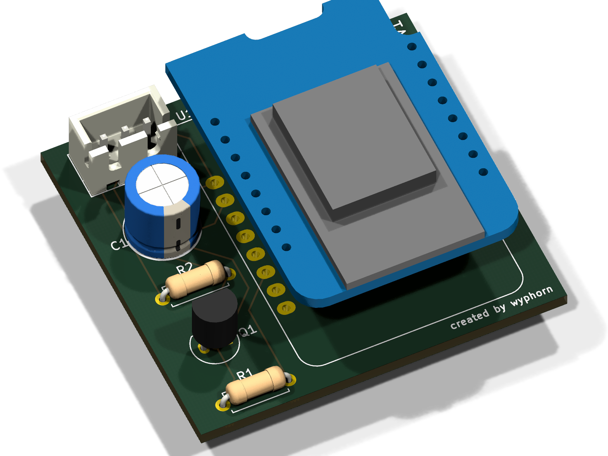

# Fogger mit ESPHome

Eine billige Nebelmaschine (**„LED-1200 Smoke Machine“**, 1200 W, mit RGB-LEDs) per **Home Assistant** steuern. Ein **WEMOS D1 Mini** mit ESPHome hängt direkt an der Steuerung des Foggers. Funk gibt es keinen mehr.



## Wie es dazu kam

Zu Halloween sollte am Eingang ein Geist auftauchen. Der Bewegungsmelder löst aus, die Musik fährt hoch, das Licht wird heller, das Stroboskop geht an und dann kommt ein Nebelstoß. Der Fogger hatte nur eine billige 24-Tasten-Fernbedienung. Ich musste ihn also irgendwie in Home Assistant bekommen.

**Versuch 1: Infrarot.** Die Fernbedienung sieht aus wie eine typische IR-Fernbedienung für RGB-Lampen. Also habe ich einen IR-Empfänger an einen ESP gehängt, um die Codes mitzulesen. Dabei kam nichts an. Der Fogger hat gar keinen IR-Empfänger.

**Versuch 2: 433 MHz.** Mit einem nanoCUL (CC1101, SIGNALduino) habe ich dann alle Tasten mitgeschnitten. Es ist einfaches OOK auf 433,92 MHz mit einem NEC-artigen Code `A7 FC <Befehl> <~Befehl>`. Für Halloween hat der ESP die Codes über den nanoCUL gefunkt, und das hat funktioniert. Zwei Probleme gab es aber:
- Ab und zu kam ein **OFF als Nebel** an. ON und OFF unterscheiden sich nur in zwei Bit. Als Notlösung hat die Automation in der Nebelphase alle 6 s OFF gesendet.
- Das WLAN am Eingang ist schwach. Ohne Stromsparmodus ging es dann (`power_save_mode: none`).

**Lösung: Kabel statt Funk.** Nach Halloween habe ich den Fogger aufgeschraubt. Der Funkempfänger ist eine eigene kleine Platine an einem 3-poligen JST-Stecker mit der Beschriftung **GND / DO / 5V**. Auf DO liegt das demodulierte Signal: HIGH, solange die Fernbedienung sendet, sonst LOW. Ich habe das Funkmodul abgezogen, und jetzt legt der D1 Mini genau dieses Signal per Kabel auf DO. Für den Fogger sieht das aus wie eine Fernbedienung mit perfektem Empfang:
- Alle 23 Tasten funktionieren, auch Farben, Stroboskop und Helligkeit.
- Die Heizungssperre des Foggers bleibt aktiv.
- Es wird nichts mehr gefunkt.

Ein Stolperstein war der Pegel: Die 3,3 V des ESP erkennt die Steuerung nicht als HIGH. Ein NPN-Transistor als Pegelwandler zieht DO auf die 5 V des Foggers, und damit lief es sofort.

## Hardware

| Ref | Bauteil | Wert |
|---|---|---|
| U1 | WEMOS D1 Mini (ESP8266) | |
| Q1 | NPN, z. B. S8050 | |
| R1 | Basiswiderstand | 1 kΩ |
| R2 | Pull-up an DO | 10 kΩ |
| C1 | Elko | 220–470 µF |
| J1 | JST-XH 3-pol. zum Fogger | |

```
JST 5V  ──┬───────────────── D1 Mini 5V ──┬── C1 +
          │                                │
         R2 10k                            │
          │                                │
JST DO  ──┴── C ┐                          │
                Q1 (NPN)                   │
D1 ── R1 1k ─── B ┤                        │
                │                          │
JST GND ──┬── E ┘                          │
          └───────────────── D1 Mini G  ───┴── C1 −
```

- Der D1 Mini wird aus den 5 V des Foggers versorgt. Er läuft also nur, wenn der Fogger an ist. Der Regler im Fogger wird dabei warm, aber nicht heiß.
- Der Transistor dreht das Signal um. Deshalb steht in der Firmware `inverted: true`.
- **Nicht D3, D4 oder D8 nehmen.** Das sind Boot-Pins des ESP8266, und mit dem Transistor an der Basis startet er dort nicht mehr.

Den Schaltplan und die Platine (THT, auch für Lochraster) findest du in [`kicad/`](kicad/).

## Firmware

[`fogger.yaml`](fogger.yaml) ist eine ESPHome-Konfiguration. Bevor du sie baust, kopierst du `secrets.example.yaml` nach `secrets.yaml` und trägst deine Daten ein.

In Home Assistant bekommst du damit:
- **Buttons** für alle Tasten der Fernbedienung, also Farben, Effekte, Helligkeit und Licht aus.
- **Nebelstoß:** ON, nach einer einstellbaren Zeit OFF. Der Ablauf läuft im ESP, auch wenn Home Assistant zwischendurch wegfällt.
- **Nebel ON / OFF:** ON hat eine Sicherheits-Höchstdauer, danach schickt der ESP selbst OFF.
- **Diagnose:** WLAN-Signal, Laufzeit, Neustart-Grund.

Alle Codes und das Protokoll stehen in [`codes.md`](codes.md).

### Weitere Dateien
- `fogger_cul.yaml`: die Halloween-Version, ein ESP32-C6 steuert über UART einen nanoCUL, der funkt.
- `fogger_c6.yaml`: die Draht-Version für einen ESP32-C6 statt D1 Mini.
- `fogger_ir_alt.yaml`, `*_log*.txt`: der Versuch mit IR und die Mitschnitte vom Auslesen.

## ⚠️ Sicherheit

In der Nebelmaschine liegen **230 V** und ein Heizblock mit mehreren hundert Grad. Öffne sie nur ausgesteckt. Bevor du etwas anschließt, prüfe, ob die Niederspannungsseite vom Netz getrennt ist. Bei mir hat ein Flyback-Netzteil mit Trafo die Seite getrennt, und zwischen GND und den Netzsteckerstiften war offen. Es gibt aber billige Geräte mit Kondensatornetzteil, und dort liegt GND auf Netzpotential.

Nachbauen auf eigene Gefahr.
